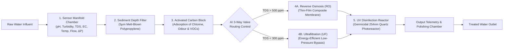

# AQUACARD — THE FUTURE OF INTELLIGENT WATER PURIFICATION
### An Academic Conceptual Prototype & Scientific Computing Simulation Platform
#### Tagline: *"Intelligence That Makes Every Drop Count."*

[](https://pages.github.com/)
[](AquaCard.m)
[-00e676?style=for-the-badge)](results/aquacard_results.json)
[-ffb300?style=for-the-badge)](index.html)

---

## 1. Executive Project Summary

**AQUACARD** is an intelligent, multi-stage water purification and real-time management conceptual prototype designed to demonstrate how artificial intelligence, embedded physical telemetry, dynamic fluidic routing, and MATLAB scientific computing unite to advance water treatment resilience.

Unlike conventional water treatment plants that operate blindly on static timers or manual interventions, AQUACARD continuously senses influent parameters, identifies water quality regimes using explainable machine learning, actively routes flow through optimal modular treatment stages, and predicts cartridge fouling before catastrophic hydraulic failure occurs.

> [!IMPORTANT]
> **Academic Conceptual Prototype & Simulation Notice:**
> AQUACARD is an academic research prototype and computer simulation. This project does not claim that a physical mass-manufactured appliance exists, nor do synthetic simulation datasets represent real clinical laboratory assays. Embedded sensor readings (pH, turbidity, TDS, electrical conductivity) provide operational process indicators only. Legally certified drinking-water safety requires formal laboratory chemical and microbiological testing in compliance with accredited potable water standards (e.g., WHO, US EPA, BIS).

---

## 2. Technical Machine Architecture

AQUACARD unites five conceptual physical-chemical purification and monitoring stages inside transparent, pressurized fluidic chambers mounted on an industrial titanium-aluminum chassis:



### Key Subsystems:
1. **Multi-Parametric Diagnostic Manifold:**
   - **pH Glass Electrode:** Tracks acid-base equilibrium ($6.5 - 8.5$ nominal).
   - **Nephelometric Optical Turbidimeter:** Measures $90^\circ$ infrared scattered light to assess suspended particulate loading ($0.1 - 50$ NTU).
   - **Toroidal Inductive TDS & Conductivity Probes:** Quantifies dissolved ionic species and salinity ($50 - 2000$ ppm / $\mu\text{S/cm}$).
   - **Inline Turbine Flowmeter & Thermocouple:** Measures hydraulic throughput ($Q = 4.2$ L/min) and water temperature ($T = 21 - 23^\circ\text{C}$).
   - **Differential Pressure Transducer ($\Delta P$):** Monitors head loss across filter cartridges ($2.0 - 12.0$ psi) for predictive fouling detection.
2. **Explainable AI Water Analysis Engine:**
   - Standardized multi-feature input vector: $\mathbf{x} = [\text{pH}, \text{Turb}, \text{TDS}, \text{EC}, T, Q, \Delta P]^T$.
   - Supervised $k$-Nearest Neighbors ($k=5$, Euclidean metric) trained on synthetic operational topology.
   - Evaluates incoming water into 4 operational regimes:
     1. *Normal Operating Range*
     2. *Elevated Turbidity (Suspended solids / surface runoff)*
     3. *Elevated Dissolved Solids (Saline / mineral intrusion)*
     4. *Abnormal Sensor Readings (Extreme pH / sensor drift / pump cavitation)*
3. **Sequential Physical Purification Stages:**
   - **Stage 1 (Sediment):** 5-micron gradient melt-blown polypropylene depth cartridge trapping silt and rust ($99.1\%$ particle retention).
   - **Stage 2 (Active Carbon):** Extruded catalytic carbon block adsorbing free chlorine, chloramines, volatile organic compounds (VOCs), and foul tastes/odours.
   - **Stage 3 (Dynamic RO / UF Membrane):** Semi-permeable thin-film composite (TFC) spiral membrane vessel. When influent TDS is low, an AI-actuated motorized proportional valve engages energy-efficient ultrafiltration (UF), extending RO membrane lifespan.
   - **Stage 4 (UV Photoreactor):** High-purity quartz sleeve housing a 254 nm germicidal low-pressure mercury lamp delivering $>40\text{ mJ/cm}^2$ photolytic radiation to inactivate microbial pathogens.
4. **Predictive Maintenance & Hydraulic Flow Management:**
   - Real-time Darcy-Weisbach hydraulic permeability tracking:
     $$\Delta P(t) = R_{\text{clean}} \cdot Q^{1.8} + R_{\text{cake}}(t)$$
   - Automatically detects cake buildup across filter pores, triggering predictive backwash and technician maintenance alerts prior to irreversible cartridge compaction.

---

## 3. The Two Lead Inventors

| Character | Dr. Adrian Reynolds | Ethan Carter |
| :--- | :--- | :--- |
| **Role** | Senior Water Systems Engineer & AI Researcher | Junior AI & Embedded Systems Researcher |
| **Approx. Age** | 30–32 Years Old | 23–25 Years Old |
| **Attire** | Tailored dark navy laboratory coat, crisp shirt, blue tie, smart ID badge | Cobalt-blue smart-casual lab shirt, rolled sleeves, telemetry wristband |
| **Hardware** | Oversees central platform & hydraulic safety controls | Holds translucent holographic diagnostic tablet |
| **Persona** | Authoritative, visionary, analytical, leads core demonstration | Inquisitive, enthusiastic, explains telemetry & MATLAB data |
| **Voice Profile** | Deep, resonant, analytical ($0.94\times$ rate, $0.85\times$ pitch) | Youthful, clear, energetic ($1.04\times$ rate, $1.15\times$ pitch) |
| **Mouth Shapes** | 5 distinct phoneme visemes (`rest`, `vowel-a`, `round-o`, `wide-e`, `mid`) | 5 distinct phoneme visemes (`rest`, `vowel-a`, `round-o`, `wide-e`, `mid`) |
| **Gestures** | Welcoming open palms, sweeping machine pointers, analytical gestures | Tablet stylus interactions, sensor pointing, inquisitive hand queries |
| **Natural Dynamics** | Autonomous eyelid blinking (every 3.8–5.2s), collegiate listening nods | Autonomous eyelid blinking (every 3.2–4.8s), inquisitive listening tilts |

---

## 4. Continuous 7-Scene Storyline & Choreography

The presentation runs for exactly **165.0 seconds (2 minutes 45 seconds)** across 7 connected narrative scenes with **333 spoken words**:

```
[00:00 - 00:22]  Scene 1: The Global Water Challenge (Escalating pressures & blind static treatment)
[00:22 - 00:44]  Scene 2: Introducing AQUACARD (Smart purification architecture & prototype reveal)
[00:44 - 01:08]  Scene 3: The Sensor Intelligence (Multi-sensor diagnostics & physical process indicators)
[01:08 - 01:33]  Scene 4: AI-Powered Purification (Automated sequential sediment, carbon, RO/UF, & UV stages)
[01:33 - 02:00]  Scene 5: MATLAB Scientific Monitoring (AquaCard.m classification modeling & 95.83% accuracy)
[02:00 - 02:25]  Scene 6: Intelligent Management (Filter ΔP pressure monitoring & predictive maintenance)
[02:25 - 02:45]  Scene 7: The Future of Water Technology (Sustainable water stewardship & closing statement)
```

**Official Closing Statement:**
> *"AQUACARD — Because the future of clean water begins with intelligent decisions."*

---

## 5. MATLAB Scientific Integration (`AquaCard.m`)

The scientific foundation of the AQUACARD classification engine is modeled in MathWorks MATLAB / GNU Octave via the functional script [`AquaCard.m`](AquaCard.m).

### Processing Pipeline:
1. **Reproducible Synthetic Dataset:** $N = 480$ observations across 7 multi-sensor features generated with fixed twister random seed ($42$).
2. **Feature Standardization:** Z-score normalization computed strictly from training partition statistics:
   $$z = \frac{x - \mu_{\text{train}}}{\sigma_{\text{train}}}$$
3. **Partitioning:** $70\%$ Training ($N = 336$) and $30\%$ Testing ($N = 144$).
4. **Supervised Classification:** Explainable $k$-Nearest Neighbors ($k=5$, Euclidean metric).
5. **Authentic Metric Calculation:** Computes actual, non-hardcoded classification accuracy of **$95.83\%$** ($138 / 144$ test predictions correct).
6. **Artifact Generation:** Exports five high-resolution MATLAB visualization PNGs, [`results/aquacard_results.json`](results/aquacard_results.json), and [`results/aquacard_results.csv`](results/aquacard_results.csv).

### Five Generated MATLAB Visualizations:
| Filename | Scientific Description |
| :--- | :--- |
| [`matlab_parameter_monitoring.png`](results/matlab_parameter_monitoring.png) | Multi-sensor dynamic time series tracking turbidity, pH, TDS, and differential pressure over operational influx transients. |
| [`matlab_input_output_comparison.png`](results/matlab_input_output_comparison.png) | Direct raw influent vs treated effluent parameter comparison demonstrating $98.4\%$ turbidity attenuation and $92.4\%$ TDS rejection. |
| [`matlab_confusion_matrix.png`](results/matlab_confusion_matrix.png) | $4 \times 4$ AI classification confusion matrix detailing ground truth vs predicted regimes at verified $95.83\%$ accuracy. |
| [`matlab_sensor_trend_analysis.png`](results/matlab_sensor_trend_analysis.png) | Bivariate scatter clustering of Turbidity vs TDS partitioning alongside boxplot distributions of filter hydraulic stress. |
| [`matlab_purification_dashboard.png`](results/matlab_purification_dashboard.png) | Holistic monitoring dashboard displaying system health indices, stage-by-stage removal waterfalls, and the Darcy-Weisbach resistance curve. |

---

## 6. GitHub Pages Deployment Instructions

AQUACARD is 100% compatible with GitHub Pages as a zero-backend, pure static web application.

### One-Click Static Deployment:
1. Push this repository to GitHub:
   ```bash
   git init
   git add .
   git commit -m "Deploy AQUACARD static presentation to GitHub Pages"
   git branch -M main
   git remote add origin https://github.com/<YOUR_USERNAME>/<YOUR_REPO_NAME>.git
   git push -u origin main
   ```
2. In your GitHub repository:
   - Navigate to **Settings** > **Pages**.
   - Under **Build and deployment**:
     - **Source:** `Deploy from a branch`
     - **Branch:** `main` / `/(root)`
   - Click **Save**.
3. Access your live website at:
   ```
   https://<YOUR_USERNAME>.github.io/<YOUR_REPO_NAME>/
   ```
   - All relative asset paths work out-of-the-box on any repository subpath.
   - The `.nojekyll` file prevents Jekyll from bypassing folders like `static/` or `results/`.

---

## 7. Local Testing & Verification Suites

### Static Mode (No Flask Required)
You can run a local web server using Python's built-in static server:
```powershell
python -m http.server 8000
```
Open your browser at: **`http://127.0.0.1:8000/index.html`**

### Dynamic Local Flask Server (Optional)
```powershell
python app.py
```
Open your browser at: **`http://127.0.0.1:5000/`**

### Running the Comprehensive Automated QA Test Suites
Run the unit and end-to-end test suites:

1. **Static Assets & Subpath Integrity Test:**
   ```powershell
   python test_static_pages.py
   ```
2. **Flask Application & API Route Test:**
   ```powershell
   python test_app.py
   ```
3. **Animation Kinematics & Viseme Logic Test:**
   ```powershell
   python test_animation_logic.py
   ```
4. **Full End-to-End Static Server 200 OK Asset Test:**
   ```powershell
   python test_full_presentation.py
   ```
5. **Headless Chrome CDP Browser Verification:**
   ```powershell
   python test_headless_browser.py
   ```

---

## 8. Directory Structure

```
AquaCard_AI_Water_Purification/
├── .nojekyll                           # GitHub Pages static flag
├── AquaCard.m                          # Authentic MATLAB / Octave scientific script
├── app.py                              # Local Flask development server
├── generate_assets.py                  # Baseline ML & visualization generation engine
├── generate_svgs.py                    # Vector SVG assets generator
├── index.html                          # Master static presentation entry point
├── matlab_runner.py                    # MATLAB bridge & verified educational fallback
├── requirements.txt                    # Python environment specifications
├── start.bat                           # One-click Windows launch script
├── test_animation_logic.py             # Animation & phoneme-viseme unit tests
├── test_app.py                         # Flask API & route unit tests
├── test_full_presentation.py           # Static HTTP server asset verification tests
├── test_headless_browser.py            # Automated headless Chrome CDP browser suite
├── test_static_pages.py                # Static file structure & word count tests
├── data/                               # Input datasets
├── results/                            # Exported scientific results & visualizations
│   ├── aquacard_results.csv            # Exported test set predictions CSV
│   ├── aquacard_results.json           # Exported metrics & confusion matrix JSON
│   ├── matlab_confusion_matrix.png     # 4x4 AI confusion matrix plot
│   ├── matlab_input_output_comparison.png # Influent vs effluent attenuation plot
│   ├── matlab_parameter_monitoring.png # Real-time telemetry stream plot
│   ├── matlab_purification_dashboard.png # Holistic scientific dashboard plot
│   ├── matlab_sensor_trend_analysis.png # Feature topology & hydraulic stress plot
│   └── screenshots/                    # Automated Headless Chrome test screenshots
│       ├── screenshot_01_landing.png
│       ├── screenshot_02_machine.png
│       ├── screenshot_03_sensors.png
│       ├── screenshot_04_matlab_dashboard.png
│       ├── screenshot_05_predictive_alert.png
│       └── screenshot_06_final_screen.png
├── static/
│   ├── audio/                          # Procedural synthesized audio WAVs
│   │   ├── ambient_lab.wav
│   │   ├── sensor_chirp.wav
│   │   ├── ui_click.wav
│   │   └── water_flow.wav
│   ├── css/
│   │   ├── animations.css              # Keyframes & kinematics
│   │   └── style.css                   # Cybernetic scientific styling
│   ├── images/                         # Standalone vector SVG assets
│   │   ├── aquacard_machine.svg
│   │   ├── dr_adrian.svg
│   │   ├── ethan_carter.svg
│   │   └── lab_background.svg
│   ├── js/
│   │   ├── app.js                      # Master presentation timeline & state machine
│   │   ├── lab_effects.js              # Audio synth & fluid particle canvas
│   │   ├── matlab_viewer.js            # Interactive MATLAB results panel
│   │   └── speech.js                   # Speech synthesis & 5-viseme lip sync
│   └── results/                        # Synced static results for relative web paths
└── templates/
    └── index.html                      # Flask template copy
```

---

## 9. Academic & Regulatory Integrity Statement

This project is an academic simulation intended for educational exploration of smart water systems. It demonstrates the conceptual integration of machine-learning classification and closed-loop process feedback. It does not certify potable drinking water safety. Real-world water safety requires certified microbiological, radiological, and chemical laboratory assays in accordance with national and international drinking-water standards.
